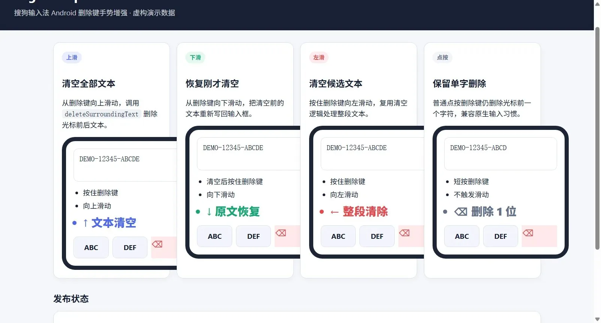
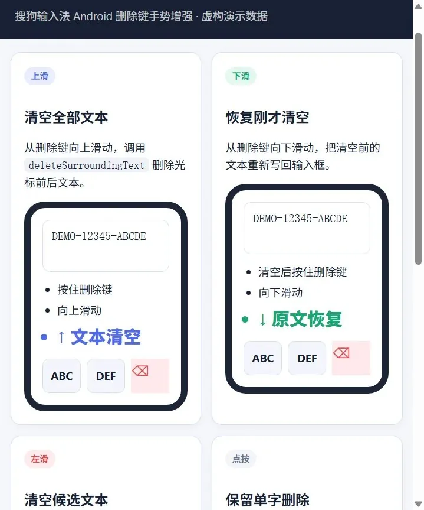

# Sogou Swipe Delete

搜狗输入法 Android 修改版：在删除键上补齐上滑清空、下滑恢复、左滑清空与点按单删手势。

## 项目定位

这是一个面向 Android 64 位设备的搜狗输入法本地修改版。项目只分发重打包后的 APK 与 Patch 说明，不包含原始搜狗 APK、反编译产物、设备测试日志或任何真实用户数据。

## 核心功能

| 手势 | 行为 |
|---|---|
| 删除键上滑 | 清空当前输入框文本 |
| 删除键下滑 | 恢复刚才清空的内容 |
| 删除键左滑 | 清空当前输入框文本 |
| 短按删除键 | 删除光标前一个字符 |

实测环境：Xiaomi MI 9 / Android 11，9 键布局；连续 5 轮“输入 → 上滑清空 → 下滑恢复”全部完整恢复。MuMu 模拟器因虚拟显示器/输入法窗口绑定不稳定，仅用作辅助调试，不作为最终验收环境。

## 界面截图



桌面视口下的四手势说明页，展示上滑、下滑、左滑与短按的目标行为。



移动视口下同一演示页，验证说明内容在小屏布局可读且覆盖核心手势。

## 快速开始

1. 从 GitHub Release 下载 `sogou-swipe-delete-android-arm64-v10.32.21-r32.apk`。
2. 在 Android 64 位设备上允许安装未知来源应用。
3. 安装 APK。若设备已有同包名的系统版本，需先确认该系统应用可以被用户版本覆盖。
4. 系统设置 → 输入法/语言与输入 → 启用本输入法，并切换为默认输入法。
5. 在任意输入框短按删除键确认单删，再测试上滑清空与下滑恢复。

## 配置参数

本项目不包含独立配置界面。手势阈值固化在 smali 代码中：

| 参数 | 默认值 | 说明 |
|---|---:|---|
| 上滑阈值 | 50dp | 纵向位移超过阈值触发清空 |
| 下滑阈值 | 50dp | 纵向位移超过阈值触发恢复 |
| 左滑阈值 | 100px | 横向位移超过阈值触发清空 |
| 恢复有效期 | 5 分钟 | 超过该时长后不再恢复上次清空内容 |

## 数据目录

APK 本身沿用搜狗输入法的原有应用数据目录；本项目不额外创建数据目录，不读取或上传聊天内容，不附带词库同步或云端服务。

## 安全说明

- 发布包使用自主测试证书签名，证书主题为 `CN=Test`，不是搜狗官方签名。
- README、文档和截图均不含真实账号、聊天记录、内网地址、密码或私钥。
- Patch 说明中的调试日志 TAG 为 `SG_PATCH`，发布版保留该 TAG 以便排障。
- 安装第三方签名输入法会替换同包名应用的既有安装；请自行做好原输入法与数据备份。
- 本项目不对输入法上游二进制中的网络行为、词库策略或隐私行为作额外承诺。

## API/自动化用法

本项目没有公开 API，也不提供命令行工具。自动化验证可通过 Android `adb` 完成：

```bash
adb install -r sogou-swipe-delete-android-arm64-v10.32.21-r32.apk
adb shell ime enable com.sohu.inputmethod.sogou.xiaomi/.SogouIME
adb shell ime set com.sohu.inputmethod.sogou.xiaomi/.SogouIME
adb shell input swipe X Y X Y_UP 700
```

自动化冒烟测试覆盖：上滑清空、下滑恢复、短按单删、左滑清空。

## 项目来源与致谢

原始 APK 为网络下载的搜狗输入法小米版 `10.32.21.202608051602`。手势设计参考微信输入法与豆包输入法的删除键交互：上滑清空、下滑撤回、删除键横向滑动处理文本/候选区。

## License

本项目 Patch 文档、README 与 CI 配置以 Apache License 2.0 发布，见 [LICENSE](LICENSE)。原始 APK 及其中第三方组件版权归各自权利人所有；本项目不授予搜狗商标、二进制或第三方组件的额外权利。
