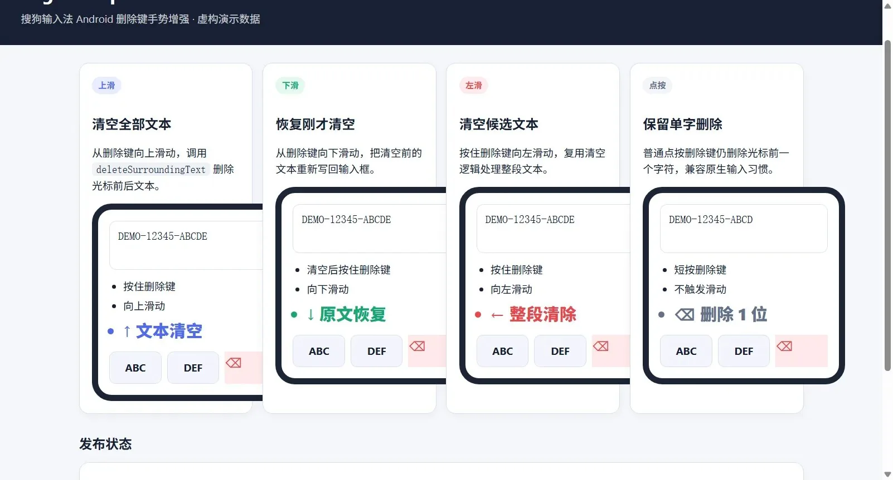
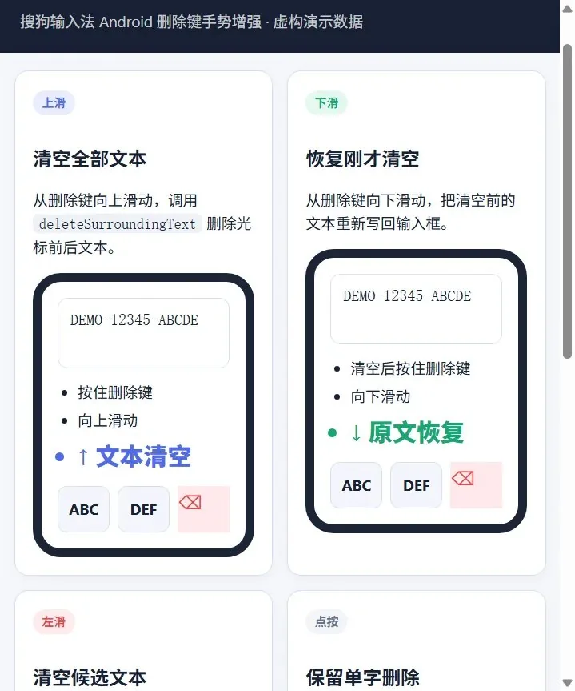

# v10.32.21-r32

搜狗输入法 Android 删除键手势增强正式版。

## 主要资产

`sogou-swipe-delete-android-arm64-v10.32.21-r32.apk`

- Package: `com.sohu.inputmethod.sogou.xiaomi`
- versionCode: `20161`
- versionName: `10.32.21.202608051602.r32`
- SHA-256: `AE2A5F46555A0F0BD5F0E35EC03EAC3FB2D62305716DB221EC0D0822BA060E19`

## 功能

- 删除键上滑：清空当前输入框文本。
- 删除键下滑：恢复刚才清空的内容。
- 删除键左滑：清空当前输入框文本。
- 短按删除键：删除光标前一个字符。

## 验证

- MI9 / Android 11 / 9 键布局：上滑清空、下滑恢复、短按单删、左滑清空通过。
- 连续 5 轮“输入 → 上滑清空 → 下滑恢复”完整恢复。
- 发布资产 SHA-256 与本地签名验证通过。
- 说明页截图由真实 Chrome 截取，使用虚构 DEMO 文本；不包含真实聊天、账号或内网信息。

## 截图

桌面视口下的四手势说明页，展示上滑、下滑、左滑与短按的目标行为。

移动视口下同一演示页，验证说明内容在小屏布局可读且覆盖核心手势。

## 说明

发布包使用自主测试证书签名，不是搜狗官方签名。请从 Release 页面下载，不要替换无法回退的生产输入数据。
