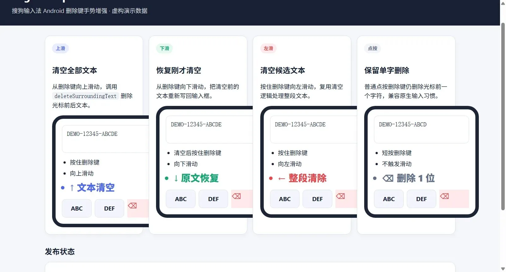
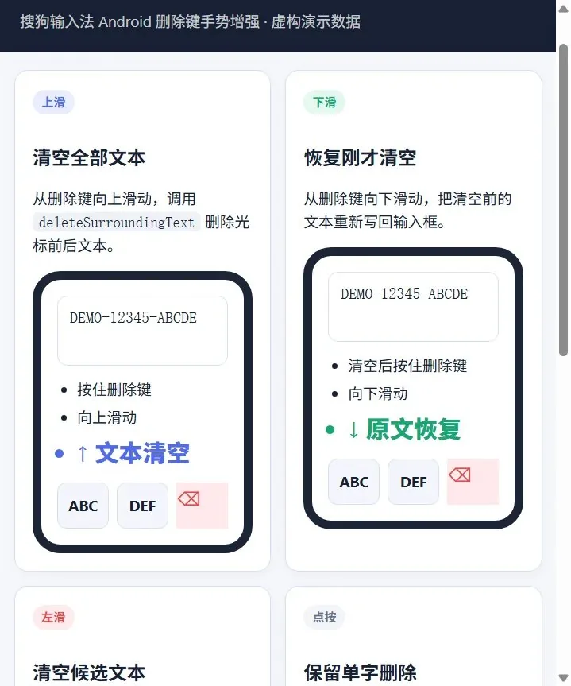

# v10.32.21-r37

搜狗输入法 Android 删除键手势增强正式版。

## 主要资产

`sogou-swipe-delete-android-arm64-v10.32.21-r37.apk`

- Package: `com.sohu.inputmethod.sogou.xiaomi`
- versionCode: `20166`
- versionName: `10.32.21.202608051602.r37`
- SHA-256: `6B68955BE50D5B2E9CB2FE13E2E8293FB85C4FD207C3FE20AEDCC6C94A25DDC7`

## 功能

- 删除键上滑：清空当前输入框文本。
- 删除键下滑：恢复最近一次上滑清空前的完整文本；清空后即使又输入新内容，仍恢复旧文本。
- 删除键左滑：清空当前输入框文本。
- 短按删除键：删除光标前一个字符（原生行为）。
- 长按删除键：逐字连续删除（原生行为）。

## 验证

- MI9 / Android 11 / 26 键布局：单击单删、长按连删、上滑清空、下滑恢复通过。
- 边界场景：清空 → 输入新内容 → 下滑，恢复的是上次清空前的文本，而不是新输入内容。
- 手势期间 IME 进程稳定，无 VerifyError/NoSuchFieldError/崩溃。
- 说明页截图由真实 Chrome 截取，使用虚构 DEMO 文本；不包含真实聊天、账号或内网信息。

## 截图

桌面视口下的四手势说明页，展示上滑、下滑、左滑与短按的目标行为。

移动视口下同一演示页，验证说明内容在小屏布局可读且覆盖核心手势。

## 说明

发布包使用自主测试证书签名，不是搜狗官方签名。请从 Release 页面下载，不要替换无法回退的生产输入数据。
